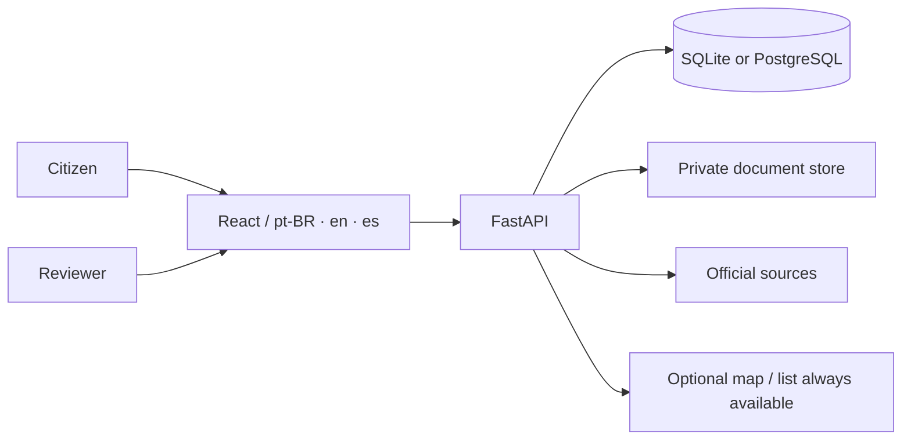

# Brasil de Todos

**English** · [Português](README.md)

**The living map of what is public.** An open-source civic platform for
exploring public services, following interventions and contributing reviewed
information about Brazilian territory. The core runs without an LLM, a vector
database or a paid map key.

[](LICENSE)
[](.python-version)
[](.nvmrc)
[](docs/READINESS.md)

> **This checkout starts empty.** National scope is a product requirement, not
> a claim about this installation. There is no demo data disguised as official
> records. `GET /api/coverage` is the truth of this instance;
> `national_catalog_certified` stays `false` even after importing a certified
> release.

## Why it exists

Brazilian public data is scattered, often lacks provenance and history, and
rarely separates **official fact**, **citizen observation**, **extracted
candidate** and **reviewed relationship**. Brasil de Todos keeps that separation
visible, preserves source/hash/reference date, and only publishes contributions
after independent review.



## Quick start

### Local SQLite

```bash
docker compose up --build
# http://127.0.0.1:8008
```

### Durable local PostgreSQL

```bash
docker compose -f docker-compose.postgres.yml up --build -d
# http://127.0.0.1:8009
```

The PostgreSQL stack has a persistent volume, a one-shot Alembic migration and
logical backup/restore. `down` keeps volumes; `down -v` removes local data.
Neither stack is production.

### Manual development

Requires **Python 3.14.8** and **Node.js 24.20.0**, pinned in the repository.

```bash
python -m venv .venv
. .venv/bin/activate
python -m pip install -e '.[test]'
bdt init-db
cd web
npm ci
npm run build
cd ..
uvicorn bdt.api:create_app --factory --host 127.0.0.1 --port 8000
```

For PostgreSQL, install `.[test,postgres]` and use
`python -m bdt.migrate upgrade --database postgresql+psycopg://...`. See
[Migrations](docs/MIGRATIONS.md).

## What works

- **Search and provenance:** filters, pagination, place pages, history,
  comparison and observed coverage.
- **Progressive map:** MapLibre/OpenFreeMap after explicit consent; clusters,
  a list that works without WebGL/GPS/tiles, and 3D only with published heights.
- **Participation:** local favorites, optional accounts, guided observations,
  review queue and publication only after independent review.
- **Private groups:** invitations, tasks, explicit observation and approved-photo
  sharing, independent review and withdrawal.
- **Documents:** native PDF extraction, conservative multipage tables, candidate
  families/dates/amounts, selective OCR, private queue, privacy signals,
  content-addressed originals and Poppler page preview.
- **PNCP:** official contract documents with metadata, SHA-256, revisions and
  private storage; nothing is published automatically.
- **Infrastructure:** Alembic `0001_baseline`, durable local PostgreSQL,
  backup/restore, non-root/read-only containers and same-origin frontend.
- **Languages:** Brazilian Portuguese, English and Spanish.

## Data and provenance

Planned sources include IBGE, Inep, CNES, PNCP, Transferegov and Obrasgov.
Historical release counts are not this instance's catalog. Read
[Sources](docs/SOURCES.md), [Data](docs/DATA.md) and
[Attribution](docs/ATTRIBUTION.md) before importing or publishing.

Rules that do not change:

- estimated value, commitment, contract and payment are never summed as if they
  were the same money;
- the buyer's municipality is not the place of execution;
- a similar name or nearby location does not create an institutional link;
- a photo, extracted text or pending observation is never published alone;
- missing geometry stays visible and searchable.

## Quality

```bash
python -m pytest
cd web && npm test && npm run build
```

Latest local state: **2,192 Python tests passed, 17 skipped**, **243 web tests
passed** and a successful Vite 8.2.4 build. Tests use synthetic data; they do not
prove currentness, national completeness or deployment. Evidence and limits:
[Status](docs/STATUS.md) and [changes/](docs/changes/).

## What is missing for 100%

There is no honest "100%" without reconciled official data, durable public
operations and community sustainability. The full checklist is in
**[Readiness](docs/READINESS.md)** (Portuguese). In short, still missing:

- a reconciled national official edition and denominators;
- an official OCR corpus and legal/privacy review;
- domain/HTTPS, durable PostgreSQL/PITR, offsite backup and a rehearsed restore;
- screen-reader and physical-device accessibility;
- licensed panoramas and a macOS lockfile.

## Contributing

Code, documentation, translations, tests, source review and accessibility work
are welcome. Read [CONTRIBUTING.md](CONTRIBUTING.md) and the
[Code of Conduct](CODE_OF_CONDUCT.md). Never attach personal data, secrets or
original documents to a public issue.

Good first steps:

- review the Portuguese documentation or improve this English guide;
- test the local PostgreSQL restore;
- audit keyboard/screen-reader flows;
- review an official source's license and schema;
- improve test coverage without hiding failures.

Security: use the private channel in [SECURITY.md](SECURITY.md), not a public
issue with exploit details.

## Documentation

[Readiness](docs/READINESS.md) · [Accessibility](docs/ACCESSIBILITY.md) · [Sources](docs/SOURCES.md) ·
[Data](docs/DATA.md) · [Architecture](docs/ARCHITECTURE.md) ·
[Operations](docs/OPERATIONS.md) · [Migrations](docs/MIGRATIONS.md) ·
[Roadmap](docs/ROADMAP.md) · [Capability matrix](docs/FEATURE_MATRIX.md)

Most product documentation is currently in Brazilian Portuguese.

## License

Original code: **AGPL-3.0-or-later** (`LICENSE`). Original documentation under
`docs/`: **CC-BY-4.0**, unless stated otherwise. Third-party data, maps,
libraries and documents keep their own licenses. This is an independent project,
not an official government channel; the license does not authorize presenting a
fork as the official instance.
