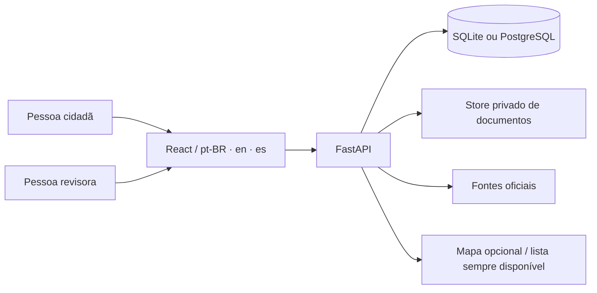

# Brasil de Todos

[English](README.en.md) · **Português**

**O mapa vivo do que é público.** Plataforma cívica open source para consultar
serviços, acompanhar intervenções e contribuir com informações revisadas sobre
o território brasileiro. O núcleo roda sem LLM, banco vetorial ou chave paga de
mapa.

[](LICENSE)
[](.python-version)
[](.nvmrc)
[](docs/READINESS.md)

> **Um clone novo começa vazio.** Escopo nacional é requisito do produto, não
> cobertura desta instalação. Não há dados demonstrativos disfarçados de
> registros oficiais. `GET /api/coverage` é a verdade desta instância;
> `national_catalog_certified` permanece `false` mesmo após importar uma edição
> certificada.

## Por que existe

Dados públicos brasileiros costumam chegar espalhados, sem proveniência clara,
sem histórico e sem separar **fato oficial**, **observação cidadã**, **candidato
extraído** e **vínculo revisado**. O Brasil de Todos mantém essa separação
visível, preserva fonte/hash/data de referência e só publica contribuições após
revisão independente.



## Começar em dois minutos

### SQLite local

```bash
docker compose up --build
# http://127.0.0.1:8008
```

### PostgreSQL local durável

```bash
docker compose -f docker-compose.postgres.yml up --build -d
# http://127.0.0.1:8009
```

O stack PostgreSQL tem volume persistente, migração Alembic one-shot e backup
lógico. `down` preserva os volumes; `down -v` apaga os dados locais. Nenhum dos
dois é produção.

### Dados nacionais verificados

As duas releases públicas podem preencher uma instalação local sem dados
sintéticos. Baixe os assets `public-data.zip` e `education-catalog.zip` das
[releases](https://github.com/rafaelob/brasildetodos/releases) e execute:

```bash
python ops/install_national_catalog.py \
  --health public-data.zip --education education-catalog.zip \
  --output data/national.db
BDT_DATABASE_URL=sqlite:///data/national.db \
  uvicorn bdt.api:create_app --factory --host 127.0.0.1 --port 8000
```

A edição instalada tem **234.209 lugares** (96.123 saúde e 138.086 escolas),
6.679 recursos e 5.571 municípios em 27 UFs. É uma fotografia histórica, não um
catálogo nacional vivo; `national_catalog_certified` continua `false`. Detalhes:
[instalação unificada](docs/UNIFIED_INSTALLATION.md) e
[evidência local](reports/20261021-national-data.json).

### Desenvolvimento manual

Requer **Python 3.14.8** e **Node.js 24.20.0**, fixados no repositório.

```bash
python -m venv .venv
. .venv/bin/activate
python -m pip install -e '.[test]'       # inclui Alembic
bdt init-db
cd web
npm ci
npm run build
cd ..
uvicorn bdt.api:create_app --factory --host 127.0.0.1 --port 8000
```

Para PostgreSQL, instale `.[test,postgres]` e use
`python -m bdt.migrate upgrade --database postgresql+psycopg://...`. O fluxo
completo está em [Migrações](docs/MIGRATIONS.md).

## O que já funciona

- **Consulta e proveniência:** busca, filtros, paginação, fichas, histórico,
  comparação de lugares e cobertura observada.
- **Mapa progressivo:** MapLibre/OpenFreeMap sob ativação explícita; clusters,
  lista sem WebGL/GPS/tiles e 3D apenas com alturas publicadas.
- **Participação:** favoritos locais, cadastro opcional, sessões, observações
  guiadas, fila de revisão e publicação somente após decisão independente.
- **Grupos privados:** convites, tarefas, compartilhamento explícito de
  observação e fotos aprovadas, revisão por outra pessoa e retirada.
- **Documentos:** extração PDF nativa, tabelas multipágina conservadoras,
  famílias/datas/valores candidatos, OCR seletivo, fila privada, sinais de
  privacidade, originais content-addressed e prévia de página com Poppler.
- **PNCP:** contratos e documentos oficiais com metadados, SHA-256, revisões e
  armazenamento privado; nenhum documento é publicado automaticamente.
- **Infra:** Alembic `0001_baseline`, PostgreSQL local durável, backup/verify,
  pins de segurança `certifi==2026.10.19`/`Pillow==13.0.0`, container
  não-root/read-only e frontend servido na mesma origem.
- **Idiomas:** pt-BR, inglês e espanhol.

## Dados e proveniência

As fontes previstas incluem IBGE, Inep, CNES, PNCP, Transferegov e Obrasgov.
Contagens de releases históricas não são o catálogo desta instância. Leia
[Fontes](docs/SOURCES.md), [Dados](docs/DATA.md) e
[Atribuição](docs/ATTRIBUTION.md) antes de importar ou publicar.

Regras que não mudam:

- valor estimado, empenho, contrato e pagamento não são somados como se fossem
  o mesmo dinheiro;
- município do comprador não é local de execução;
- nome/proximidade não criam vínculo institucional;
- foto, texto extraído e observação pendente não são publicados sozinhos;
- ausência de geometria continua visível e pesquisável.

## Qualidade

```bash
python -m pytest
cd web && npm test && npm run build
```

Estado local recente: **2.192 testes Python aprovados, 17 ignorados**, web
**243 aprovados** e build Vite 8.2.4. Testes usam dados sintéticos; não provam
atualidade, completude nacional ou deploy. Evidências e limites:
[Status](docs/STATUS.md) e [changes/](docs/changes/).

## O que falta para 100%

Não existe “100%” sem dados oficiais reconciliados, operação pública durável e
sustentabilidade comunitária. O quadro honesto está em
**[Prontidão](docs/READINESS.md)**. Em resumo, ainda faltam:

- edição nacional oficial reconciliada e denominadores;
- corpus oficial de OCR e revisão jurídica/privacidade;
- domínio/HTTPS, PostgreSQL durável/PITR, backup offsite e restauração ensaiada;
- leitor de tela e dispositivos físicos;
- panoramas licenciados e locks para macOS Intel/outras arquiteturas.

## Como contribuir

Contribuições de código, documentação, tradução, testes, revisão de fontes e
acessibilidade são bem-vindas. Leia [CONTRIBUTING.md](CONTRIBUTING.md), siga o
[Código de Conduta](CODE_OF_CONDUCT.md) e nunca anexe dados pessoais, segredos
ou documentos originais em issue pública.

Bons primeiros passos:

- revisar a documentação em inglês/espanhol;
- testar restauração do backup PostgreSQL local;
- auditar teclado/leitor de tela nos percursos;
- revisar licença e formato de uma fonte oficial;
- melhorar cobertura de testes sem mascarar falhas.

Segurança: use o canal privado descrito em [SECURITY.md](SECURITY.md), não uma
issue pública com detalhes de exploração.

## Documentação

[Prontidão](docs/READINESS.md) · [Acessibilidade](docs/ACCESSIBILITY.md) · [Fontes](docs/SOURCES.md) ·
[Dados](docs/DATA.md) · [Arquitetura](docs/ARCHITECTURE.md) ·
[Operação](docs/OPERATIONS.md) · [Migrações](docs/MIGRATIONS.md) ·
[Roadmap](docs/ROADMAP.md) · [Matriz de capacidades](docs/FEATURE_MATRIX.md)

## Licença

Código original: **AGPL-3.0-or-later** (`LICENSE`). Documentação original em
`docs/`: **CC-BY-4.0**, salvo indicação específica. Dados, mapas, bibliotecas e
documentos de terceiros conservam suas licenças. Projeto independente, sem
afiliação presumida a órgão público; a licença não autoriza apresentar um fork
como a instância oficial.
